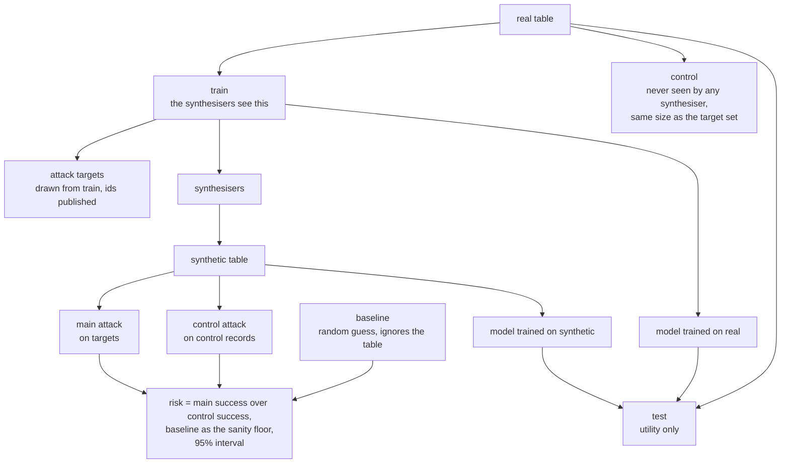
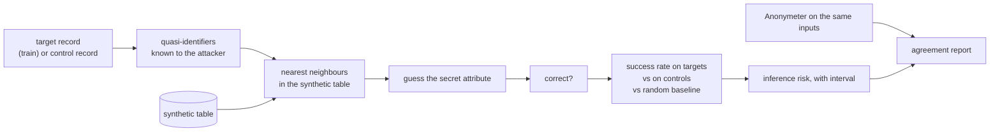
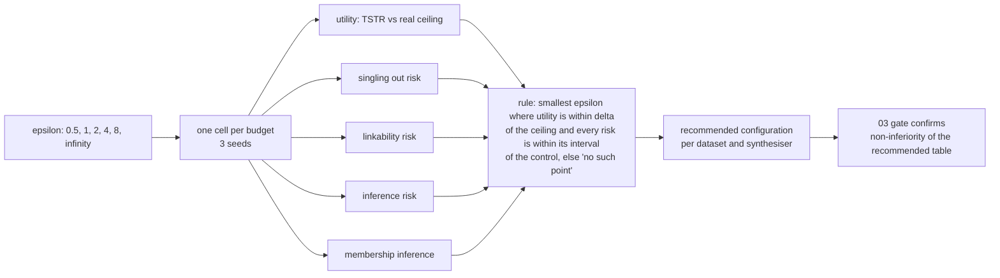

# Architecture

The diagrams behind [PLAN.md](../PLAN.md), in Mermaid so they render on GitHub and change in
the same commit as the code they describe. Four views: the pipeline, the three-way split
that makes the attack arithmetic honest, one attack's anatomy, and the surface.

## 1. The pipeline

Real tables in, a grid of synthetic tables, every table attacked and scored, one surface out.

```mermaid
flowchart LR
  subgraph data["Real microdata (fetched, checksummed, terms quoted)"]
    ACS["ACS PUMS via folktables<br/>census respondents"]
    CIS["IEEE-CIS<br/>card transactions (09's terms)"]
    SP["NY SPARCS discharges<br/>if the terms permit"]
  end
  data --> subset["subset + prep<br/>attribute subset, uniform binning,<br/>rare-category merge (recorded)"]
  subset --> split["split<br/>train · control · test<br/>attack targets; leakage check"]
  split --> grid

  subgraph grid["Synthesiser grid: 6 methods x 6 budgets x 3 seeds"]
    NDP["non-DP: Gaussian copula, CTGAN, TVAE (SDV)"]
    DPM["DP marginal: AIM, MST (SmartNoise / Private-PGM)"]
    DPD["DP deep: PATE-CTGAN (SmartNoise)"]
  end
  grid --> tables[("data/synth<br/>one table per cell,<br/>seed, epsilon, wall-clock")]

  tables --> attacks["attacks (from the papers)<br/>singling out · linkability · inference<br/>Groundhog MIA · DCR"]
  tables --> reference["reference check<br/>Anonymeter, TAPAS<br/>on the same tables"]
  tables --> utility["utility<br/>train-on-synthetic, test-on-real<br/>ceiling, floor; marginal error"]
  attacks & reference & utility --> results[("outcomes per table<br/>bootstrap intervals")]
  results --> surface["surface<br/>epsilon vs utility vs risk;<br/>the recommendation rule"]
  results --> gate["03 gate<br/>synthetic-trained vs real-trained"]
  surface & gate --> report["report<br/>README tables, leak table, site JSON"]
  report --> site["privacy.peterparker.ca (static)"]
```

## 2. The three-way split

Why there is a control set: the attack's success on records the synthesiser never saw is what
the synthetic table reveals about anyone; the excess on records it did see is the leak.

## 3. One attack, the legal test's inference risk

The shape every attack in `facsimile/attacks/` follows; the predicates and the neighbour
search differ, the three-way design does not.

## 4. The surface

One chart per dataset and synthesiser; the recommendation is where the rule says, or nowhere.

