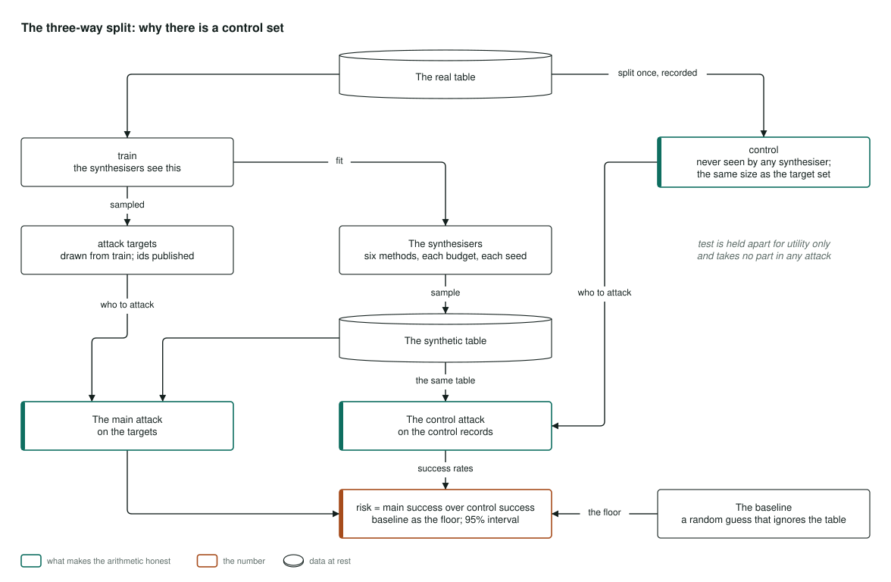

# Architecture

The figures behind [PLAN.md](../PLAN.md), drawn before the first line of code so the design
cannot be shaped to fit the result. Four views: the pipeline, the three-way split that makes
the attack arithmetic honest, one attack's anatomy, and the surface. Nothing in them is
measured yet; the module names are the plan's.

## The pipeline

Three real datasets, their terms quoted in `docs/data.md` before the first fetch, come in:
ACS PUMS census microdata via folktables, IEEE-CIS transactions under the terms project 09
recorded, and NY SPARCS hospital discharges only if its terms permit (`facsimile.data`). Each
is prepared with a recorded attribute subset, uniform binning and rare-category merging, and
split three ways: a training set the synthesisers see, a control set they never see, and a
test set for utility, with the attack targets drawn and a leakage check (`facsimile.split`).
The synthesiser grid is seven methods at six privacy budgets and three seeds: Gaussian copula,
CTGAN and TVAE through SDV, TabDDPM through synthcity, and AIM, MST and PATE-CTGAN through
SmartNoise, every epsilon from
a library's own accountant (`facsimile.synth`), one table per cell. Every table is attacked
with singling out, linkability and inference implemented from the paper that defines the legal
test, the Groundhog membership inference attack and distance to closest record, each checked
against Anonymeter and TAPAS on the same tables (`facsimile.attacks`, `facsimile.reference`),
and scored for utility as a model trained on synthetic data and tested on real, against the
real-data ceiling, with marginal error reported as fidelity and never as utility
(`facsimile.utility`). The outcomes per table carry bootstrap intervals; the surface and its
recommendation rule (`facsimile.surface`) and the release gate's verdict on the recommended
table feed the report, which writes the README tables, the leak table and the JSON behind the
static explorer at privacy.peterparker.ca.

## The three-way split

The real table is split once and the split recorded. The synthesisers are fitted on the
training split alone and sampled into a synthetic table. The attack targets are drawn from the
training split with their ids published; the control set is never seen by any synthesiser and
is the same size as the target set; the test split takes no part in any attack. The main
attack runs on the targets and the control attack on the control records against the same
synthetic table, and a random guess that ignores the table is the baseline. The risk is the
main success rate over the control success rate with the baseline as the sanity floor, and a
95% interval, which is what keeps an attack's success on strangers from being counted as a
leak.

## One attack: the inference risk

Every attack in `facsimile.attacks` follows one shape; the predicates and the neighbour search
differ, the three-way design does not. For a target record or a control record, the attacker
is assumed to know the quasi-identifiers, finds the record's nearest neighbours in the
synthetic table, and guesses the secret attribute from them. Correct or not is aggregated into
a success rate on the targets, on the controls and for the random baseline, and the inference
risk with its interval comes from the ratio. Anonymeter is run on the same inputs and a
disagreement is resolved and recorded before a number ships.

## The surface

For each dataset and synthesiser, the budgets 0.5, 1, 2, 4, 8 and no privacy at all are one
cell each with three seeds. Every cell is read five ways: utility against the real ceiling,
singling out, linkability, inference and membership inference. The rule (`facsimile.surface`)
picks the smallest epsilon where utility is within delta of the ceiling and every risk is
within its interval of the control, or says plainly that there is no such point. The
recommended configuration per dataset and synthesiser is then handed to project 03's gate,
which confirms the non-inferiority of a model trained on the recommended table against one
trained on the real data.
